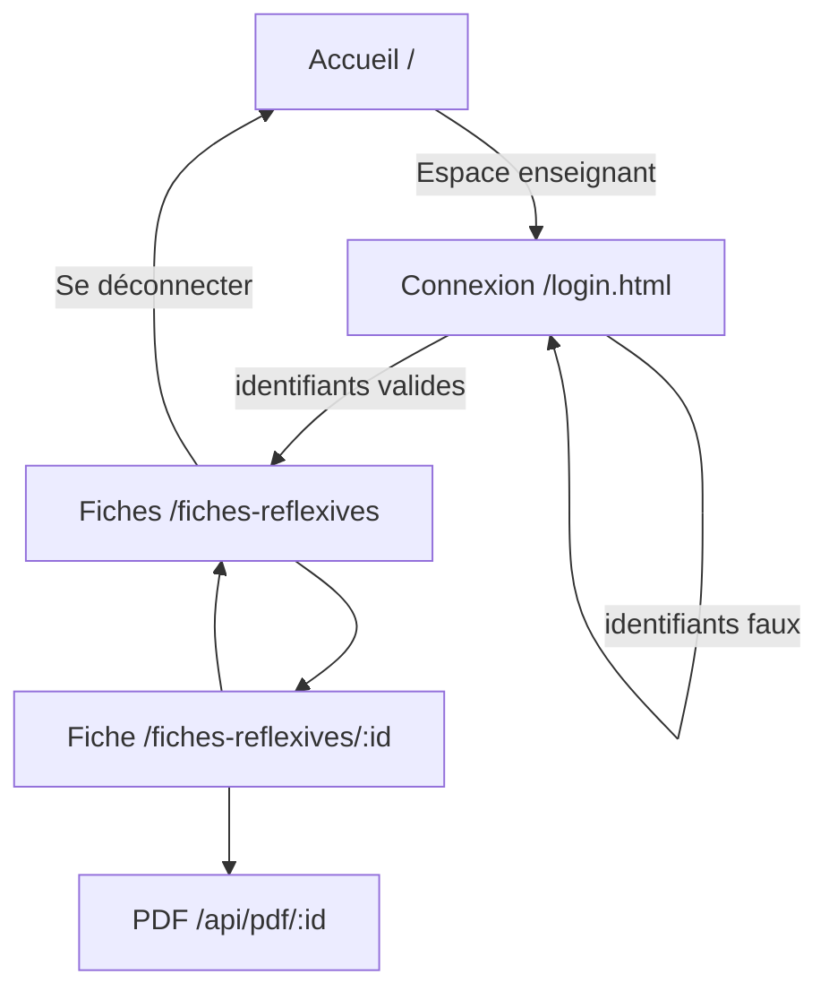
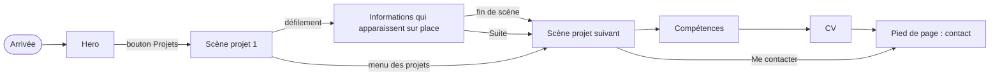
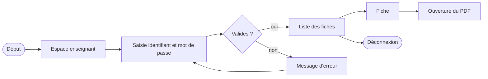
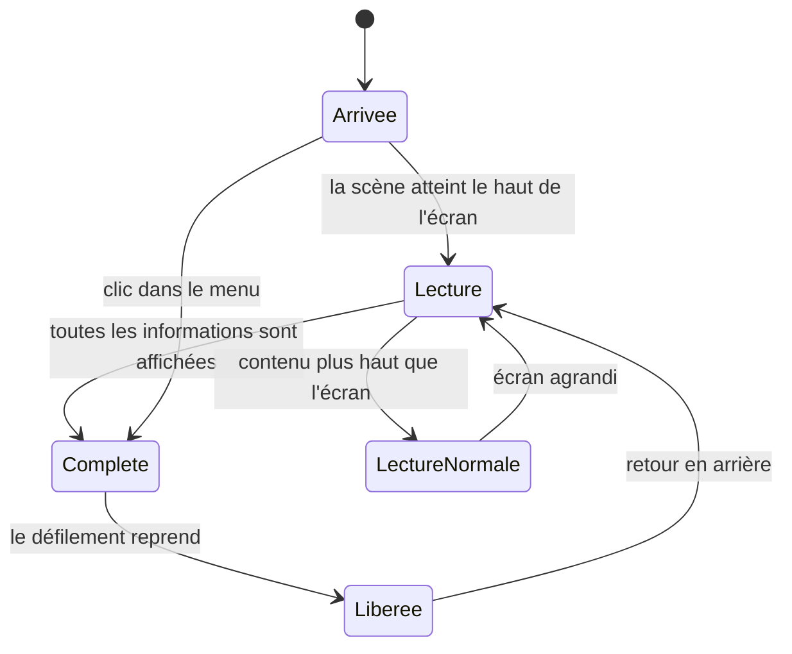
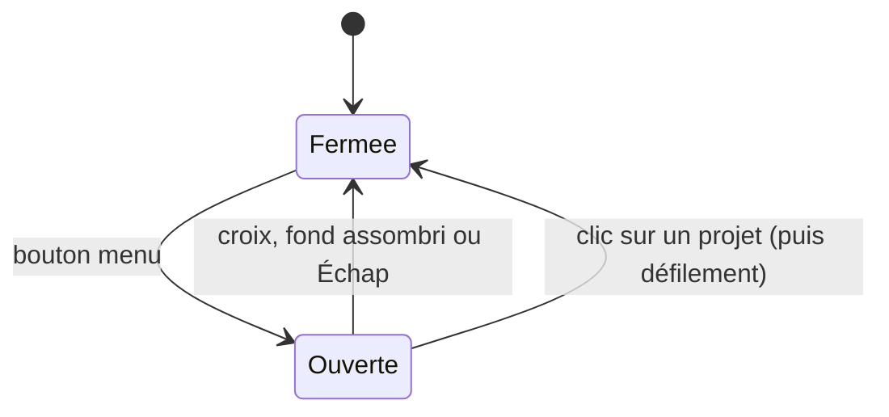
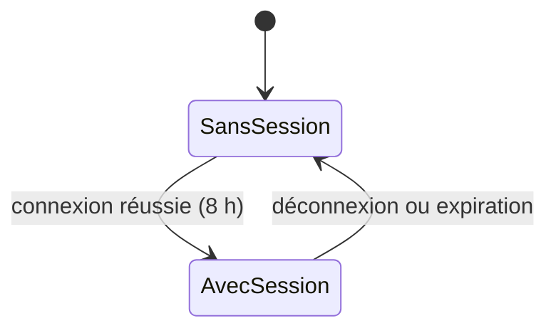

# App flow — Portfolio d'Alex

Statut : brouillon
Couvre : US-01 … US-12

Schémas seulement. Le détail des exigences est dans `PRD.md`.

## 1. Carte des écrans et vues

| Écran / vue | Rôle | Accès depuis |
|---|---|---|
| Accueil `/` | Hero, 5 projets, compétences, CV, pied de page | URL, lien du site |
| Scène projet (dans l'accueil) | Un projet par écran : titre, tags, aperçu, résumé, points clés, liens | Bouton « Projets » du hero, menu des projets, « Suite » |
| Vue latérale des projets (mobile) | Liste des projets sur la moitié de l'écran | Bouton de la barre de section |
| Connexion `/login.html` | Identifiant et mot de passe de l'enseignant | Lien « Espace enseignant » |
| Fiches, fiche, PDF | Espace enseignant protégé | Connexion réussie |

## 2. Parcours utilisateur

### Parcours US-01 : parcourir les projets

| Étape | Action utilisateur | Réponse du système | Cas d'erreur |
|---|---|---|---|
| 1 | Clique « Projets » dans le hero | Défilement lisse jusqu'à la scène du projet 1 ; le titre est déjà visible (sur mobile : l'aperçu) | Sans JavaScript : saut d'ancre, tout est visible |
| 2 | Défile dans un projet | Le contenu ne bouge pas ; les informations apparaissent dans l'ordre de lecture ; le cercle de points grandit depuis l'aperçu | Écran trop bas : le projet passe en lecture normale, tout est visible |
| 3 | Atteint la fin du projet | Tout est affiché ; le trait de défilement disparaît ; le défilement reprend sur le projet suivant | — |
| 4 | Clique un projet dans le menu | Défilement jusqu'à la fin de la scène choisie, tout révélé | — |
| 5 | Clique « Suite : … » | Défilement jusqu'au début du projet suivant (ou « Me contacter » pour le dernier) | — |

### Parcours US-07 à US-09 : espace enseignant

## 3. États des écrans clés

### Scène projet

### Vue latérale des projets (mobile)

### Accès aux pages protégées

## 4. Desktop / mobile

| Point du parcours | Desktop (≥ 48rem) | Mobile (< 48rem) |
|---|---|---|
| Menu des projets | Fixe à gauche, projet en cours marqué | Barre de section « Projets \| projet en cours » et bouton ; vue latérale sur la moitié de l'écran |
| Ordre d'apparition | Titre, puis tags et aperçu, résumé, points clés, liens | Aperçu, puis titre et tags, résumé, points clés (qui remplacent le résumé), liens |
| Aperçu | Colonne de droite (7/12) | Au-dessus du titre, prend la hauteur libre |
| Écran trop bas | Lecture normale (constaté à 1024×768) | Lecture normale (constaté à 700×340) ; à 375×667 la scène tient |

## 5. Clavier et accessibilité du parcours

- Les informations pas encore révélées sont `inert` : Tab ne les atteint pas. En lecture normale ou sous `prefers-reduced-motion`, tout est atteignable.
- Ordre de tabulation d'un projet : titre (non focalisable), lien de l'adresse du cadre, liens Site et GitHub, « Suite ».
- Vue latérale : à l'ouverture au clavier, le focus va au premier projet ; Tab et Maj+Tab restent dans la vue ; `Échap` ferme et rend le focus au bouton menu.
- Le fond de points est décoratif (`aria-hidden`). La progression n'est donnée que visuellement.

## 6. Questions ouvertes

- Faut-il annoncer la progression (projet 2 sur 5) aux lecteurs d'écran, ou le menu suffit-il ?
- Sur 1024 px de large (iPad paysage, petit portable), la disposition en colonne fait basculer les projets en lecture normale. Faut-il garder la disposition à deux colonnes jusqu'à 960 px ?
