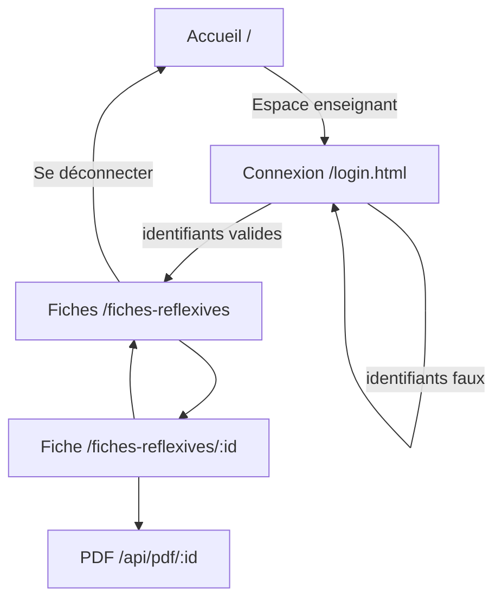
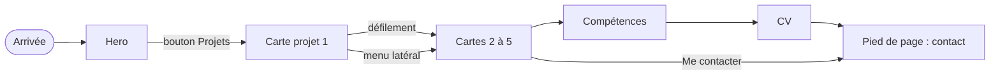
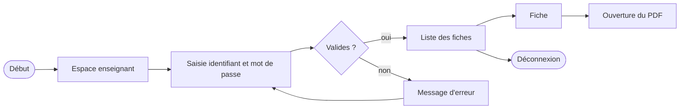
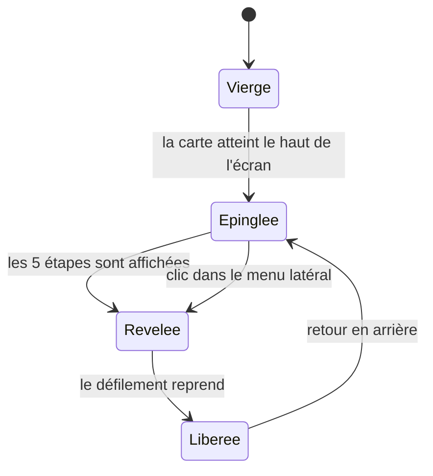
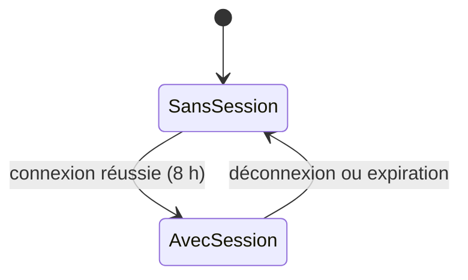

# App flow — Portfolio d'Alex

Statut : brouillon
Couvre : US-01 … US-12

Schémas seulement. Le détail des exigences est dans `PRD.md`.

## 1. Carte des écrans

## 2. Parcours visiteur sur l'accueil

## 3. Parcours enseignant

## 4. États d'une carte projet

## 5. Accès aux pages protégées

## 6. Questions ouvertes

- Sur mobile, comment atteindre un projet précis sans le menu latéral (PRD F-17) : liste en tête de section, ou barre fixe ?
