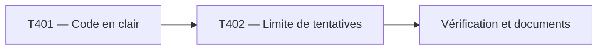

# Plan d'implémentation — Connexion enseignant : code en clair et limite de tentatives

Statut : livré sur la branche, en attente de validation d'Alex
Couvre : PRD F-10, F-21, NF-03 ; TRD T-02, T-03, T-04
Branche : `feature/code-acces-limite-tentatives` (depuis `dev`). Merge sur `dev` en `--no-ff` après accord d'Alex.

## 1. Objectif du lot

Le code d'accès est une variable `AUTH_CODE` en clair (`.env` local, variables Netlify) : plus de hash à générer. En échange, `/api/login` limite les tentatives : 5 échecs par adresse IP bloquent la connexion 15 minutes.

## 2. Décisions préalables

| # | Question | Décision | Raison |
|---|---|---|---|
| 1 | Hash ou clair | Clair dans `AUTH_CODE` ; `bcryptjs`, `AUTH_PASSWORD_HASH` et `scripts/hash-password.js` retirés | Alex est seul sur le site ; le hash ajoutait une étape à chaque changement de code et ne protège que d'une fuite de la variable |
| 2 | Comparaison | `crypto.timingSafeEqual` sur les empreintes SHA-256 des deux valeurs | Durée de comparaison indépendante du nombre de caractères justes ; longueurs égales exigées par `timingSafeEqual` |
| 3 | Mécanisme de limite | Compteur d'échecs dans Netlify Blobs (store `login-attempts`), clé = IP | Le dépôt utilise déjà Blobs ; aucun service externe |
| 4 | Seuil | 5 échecs, blocage de 15 minutes à partir du premier échec de la série | Valeur courante ; un enseignant qui se trompe attend au plus 15 minutes |
| 5 | Identification du client | En-tête `x-nf-client-connection-ip` posé par Netlify | `X-Forwarded-For` peut être falsifié par l'appelant |
| 6 | Blocage et bon code | Refus même avec le bon code pendant le blocage | Sinon la force brute continue de répondre |
| 7 | Blobs indisponible | La connexion reste possible, erreur journalisée | Ne pas enfermer l'enseignant dehors lors d'une panne ; contrepartie : pas de limite pendant la panne |
| 8 | Signal d'erreur | Redirection vers `/login.html?error=2` | Le `fetch` de la fenêtre suit la redirection et lit `error` dans l'URL finale |

## 3. Phases

## 4. Tâches

| ID | Tâche | Story | Fichiers cibles | Dépend de | [P] | Statut |
|---|---|---|---|---|---|---|
| T401 | Code d'accès en clair, comparaison en temps constant | US-07 | `netlify/functions/lib/auth.js`, `scripts/hash-password.js`, `package.json`, `package-lock.json`, `.env.example`, `README.md` | — | non | fait |
| T402 | Limite de tentatives par IP | US-07 | `netlify/functions/lib/rate-limit.js`, `netlify/functions/login.js`, `public/js/login-dialog.js`, `public/login.html` | T401 | non | fait |

T402 dépend de T401 : son contrôle du handler utilise `AUTH_CODE`.

## 5. Vérification du lot

| Contrôle | Commande / méthode | Attendu |
|---|---|---|
| Syntaxe | `node --check` sur chaque fichier JS modifié | succès |
| Code | contrôle de T401 | `code ok` |
| Compteur | contrôle de T402 avec store simulé | `compteur ok` |
| Handler sans Blobs | contrôle de T402 | `login ok` |
| Navigateur | fenêtre de connexion, route `/api/login` simulée : « Code incorrect. » puis « Trop de tentatives… » pour `error=2` | messages corrects, URL inchangée |
| Blobs réel | `netlify dev` : 6 codes faux de suite, puis le bon | 6e réponse bloquée, le bon code refusé pendant le blocage |

## 6. Risques

| Risque | Probabilité | Impact | Parade |
|---|---|---|---|
| Course entre deux tentatives simultanées (lecture puis écriture non atomique) | Faible | Faible | Quelques essais en trop au plus ; seuil de 5 laisse de la marge |
| Plusieurs adresses IP pour la force brute | Faible | Moyen | Code d'au moins 12 caractères |
| Panne de Blobs : plus de limite | Faible | Moyen | Journalisation ; code long |
| Code en clair lisible dans l'interface Netlify | Faible | Moyen | Accès au site réservé à Alex ; changer le code si le compte est partagé |

## 7. Suivi

| Tâche | Commit | Vérifié le | Remarque |
|---|---|---|---|

## Questions ouvertes

- Alex garde-t-il l'ancienne variable `AUTH_PASSWORD_HASH` sur Netlify en attendant le déploiement ? Elle devient inutile, `AUTH_USERNAME` aussi : à supprimer une fois `AUTH_CODE` posé.
