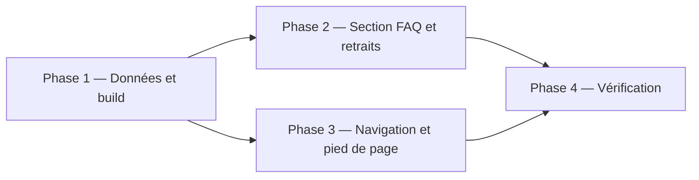
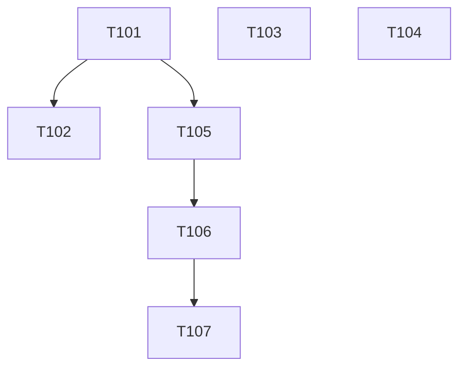

# Plan d'implémentation — Section FAQ dans un losange ouvert

Statut : livré sur la branche, en attente de validation d'Alex
Couvre : PRD F-01, F-04, F-07, F-08, F-09, F-19, NF-09, NF-13 ; TRD T-18 à T-20
Branche : `feature/faq` (depuis `dev`). Merge sur `dev` en `--no-ff` après accord d'Alex.

## 1. Objectif du lot

La dernière section de l'accueil devient une FAQ de 5 questions sur le profil d'Alex : une scène d'un écran, une réponse affichée à la fois, fond uni sans point. Un premier essai encadré par un losange ouvert a été écarté par Alex. La section CV disparaît, l'adresse email n'apparaît plus nulle part dans le site, la marque de la barre de navigation devient « korrighed.dev » et les liens « Suite : … » de la section Projets disparaissent. Les questions sont une donnée unique, rendue en HTML et en données structurées `FAQPage` pour le référencement.

## 2. Décisions préalables

| # | Question | Décision | Raison |
|---|---|---|---|
| 1 | CV et prise de contact | Hors lot : le CV reste en local, le formulaire de contact viendra plus tard | Demande d'Alex |
| 2 | Adresse email | Retirée du pied de page et du HTML généré, sans la remplacer par un lien | Demande d'Alex : l'adresse ne doit pas être lisible sur le site |
| 3 | Source des questions | `src/data/faq.json`, rendue par `scripts/build-index.js` en HTML et en JSON-LD | Une seule source : le texte visible et les données structurées ne peuvent pas diverger |
| 4 | Losange ouvert autour de la réponse | Abandonné après essai (« un raté », Alex) ; la capture « Sans titre.png » n'était qu'un exemple | Demande d'Alex |
| 5 | Fond de points | Aucun point : ils venaient du canvas `#projets-bg` (sticky, `z-index: 0`) qui se dessinait par-dessus la FAQ ; la section passe en `z-index: 1` avec un fond Platinum uni (T107) | Demande d'Alex |
| 10 | Mise en page | Une scène d'un écran : onglets (liste à gauche, panneau à droite dès 64rem ; pastilles numérotées en dessous), panneaux empilés dans la même cellule pour ne rien décaler | Demande d'Alex : tout doit tenir dans un seul écran |
| 6 | Technologies (Front / Back / Outils) | Retirées avec la section Compétences ; la stack de chaque projet reste dans ses tags | « À la place de Compétences » |
| 7 | Espace enseignant, connexion, PDF | Inchangés | Hors périmètre ; voir Questions ouvertes |
| 8 | « Suite : … » des scènes projet | Supprimés (code compris) : le menu des projets suffit | Demande d'Alex : ils ne servent à rien, la navigation existe |
| 9 | Marque de la barre de navigation | « korrighed.dev » (texte) ; le domaine sera korrighed.dev | Demande d'Alex : le nom de domaine « Alex » est trop cher. Lecture de « l'entête avait sauté » : à confirmer |

## 3. Phases

## 4. Tâches

| ID | Tâche | Story | Fichiers cibles | Dépend de | [P] | Statut |
|---|---|---|---|---|---|---|
| T101 | Données FAQ et rendu au build | US-04 | `src/data/faq.json`, `scripts/build-index.js` | — | | fait |
| T102 | Section FAQ, retrait Compétences et CV, métadonnées | US-04 | `src/sections/faq.html`, `public/css/faq.css`, `src/index.template.html`, anciens fichiers | T101 | | fait (mise en page remplacée par T106) |
| T103 | Navigation (marque korrighed.dev) et pied de page sans email | US-06 | `src/sections/nav.html`, `src/sections/footer.html` | — | [P] | fait |
| T104 | Retirer les « Suite : … » de la section Projets | US-01 | `src/sections/projets.html`, `public/css/projets.css`, `public/js/projets-scroll.js` | — | [P] | fait |
| T105 | Rendu de la FAQ en onglets et panneaux au build | US-04 | `scripts/build-index.js` | T101 | | fait |
| T106 | FAQ en une scène d'un écran (onglets, panneaux, script) | US-04 | `src/sections/faq.html`, `public/css/faq.css`, `public/js/faq.js`, `src/index.template.html` | T105 | | fait |
| T107 | Retirer les points du fond et le losange | US-04 | `src/sections/faq.html`, `public/css/faq.css` | T106 | | fait |

Fichier détaillé de chaque tâche : `docs/tasks/Txxx-slug.md`.

## 5. Graphe de dépendances

T103 et T104 ne partagent aucun fichier avec T101 et T102 ni entre eux : ils s'exécutent en parallèle de T101. Chaque tâche relance `npm run build` ; `public/index.html` est régénéré une dernière fois à la fin du lot.

## 6. Vérification du lot

| Contrôle | Commande / méthode | Attendu |
|---|---|---|
| Build | `npm run build` | succès, `public/index.html` régénéré |
| Email | recherche de `protonmail` et `mailto` dans `public/` et `src/` | 0 occurrence |
| Données structurées | un seul bloc `application/ld+json` avec 5 `Question` | conforme |
| Parcours | APP-FLOW, accueil | FAQ visible dans le losange, nav « Questions » mène à `#faq` |
| Responsive | 1280×720, 1024×768, 390×844 | rien ne dépasse, chevrons visibles, texte lisible |
| Mouvement réduit | `prefers-reduced-motion` | inchangé (la section n'a pas d'animation) |

## 7. Risques

| Risque | Probabilité | Impact | Parade |
|---|---|---|---|
| Chevrons qui chevauchent le texte sur écran étroit | Moyenne | Moyen | Marges internes en `%` supérieures à la taille des chevrons ; contrôle à 390 px |
| Lien « Me contacter » du menu des projets mène au pied de page, qui n'a plus d'email | Certaine | Faible | Accepté jusqu'au lot « contact » ; à signaler à Alex |
| L'adresse reste dans l'historique git et dans les copies déjà déployées | Certaine | Moyen | Hors périmètre du code ; à signaler à Alex |

## 8. Suivi

| Tâche | Commit | Vérifié le | Remarque |
|---|---|---|---|

## Questions ouvertes

- Faut-il supprimer l'Espace enseignant, la connexion et le service du PDF, maintenant que le CV n'est plus en ligne ? Ils servent aux fiches réflexives, pas au CV.
- Le lien « Me contacter » du menu des projets doit-il être retiré en attendant le formulaire ?
