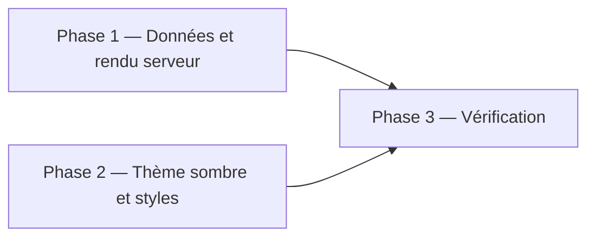
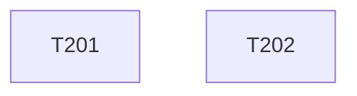

# Plan d'implémentation — Espace enseignant : fiches en scène sombre

Statut : livré sur la branche, en attente de validation d'Alex
Couvre : PRD F-11, F-12, F-20 ; TRD T-22, T-23
Branche : `feature/espace-enseignant` (depuis `dev`). Merge sur `dev` en `--no-ff` après accord d'Alex.

## 1. Objectif du lot

La page protégée `/fiches-reflexives` reprend la scène à onglets de la FAQ, en version sombre : le titre de chaque fiche est dans le menu, et le panneau affiche les informations liées aux compétences (compétences visées, livrables, statut, date, liens). Les trois fiches réelles remplacent la fiche de test.

## 2. Décisions préalables

| # | Question | Décision | Raison |
|---|---|---|---|
| 1 | Mise en page | Réutiliser la scène de la FAQ (classes `faq__*`, `faq.js`, `faq-ripple.js`) avec un modificateur `faq--dark` | Alex aime l'aspect de la FAQ : une seule implémentation à maintenir |
| 2 | Couleurs | Jetons `--faq-*` dans `faq.css` ; `faq--dark` = fond Ink Black, texte Platinum, accent et filets Powder Blue | « Inverser les couleurs avec un fond sombre » |
| 3 | Où vivent les métadonnées | `netlify/functions/lib/fiche-repository.js`, rendues côté serveur sur la page protégée | Les titres et compétences ne sont servis qu'avec une session valide |
| 4 | Page de détail `/fiches-reflexives/:id` | Redirige vers `/fiches-reflexives` (le panneau remplace la page) | Un seul écran |
| 5 | Fiche de test `fiche-1` | Remplacée par les trois fiches réelles | Données fournies par Alex |
| 6 | PDF | Un lien « Ouvrir la fiche (PDF) » par fiche vers `/api/pdf/:id` ; noms de fichiers dans Blobs : `fiche-affmar.pdf`, `fiche-hotfix-ci-cd.pdf`, `fiche-yozora.pdf` | Convention de `fiche-1.pdf` ; à déposer par Alex (voir Questions ouvertes) |
| 7 | Page de connexion | Inchangée dans ce lot | Hors périmètre |

## 3. Phases

## 4. Tâches

| ID | Tâche | Story | Fichiers cibles | Dépend de | [P] | Statut |
|---|---|---|---|---|---|---|
| T201 | Données des fiches et rendu serveur de la scène | US-08 | `netlify/functions/lib/fiche-repository.js`, `netlify/functions/lib/fiches-view.js`, `netlify/functions/lib/page.js`, `netlify/functions/fiche-list.js`, `netlify/functions/fiche-detail.js` | — | [P] | fait |
| T202 | Thème sombre, styles des fiches, couleur des points | US-08 | `public/css/faq.css`, `public/css/fiches.css`, `public/js/faq.js`, `public/js/faq-ripple.js` | — | [P] | fait |

T201 et T202 ne partagent aucun fichier. Le contrat entre les deux est le balisage décrit dans T201 (classes `faq__*`, `faq--dark`, `espace__*`, `fiche__*`), que T202 stylise.

## 5. Graphe de dépendances

## 6. Vérification du lot

| Contrôle | Commande / méthode | Attendu |
|---|---|---|
| Syntaxe | `node --check` sur chaque fichier JS modifié | succès |
| Rendu serveur | appel du handler avec un cookie de session forgé | HTML avec 3 onglets, 3 panneaux, aucune erreur |
| Sans session | appel du handler sans cookie | 302 vers `/login.html` |
| Navigateur | 1280×720, 1024×768, 390×844 | scène lisible sur fond sombre, une fiche à la fois, rien ne se décale, points absents sous le texte |
| FAQ de l'accueil | mêmes contrôles qu'avant | inchangée (fond clair, points Yale) |

## 7. Risques

| Risque | Probabilité | Impact | Parade |
|---|---|---|---|
| Une fiche dépasse l'écran (compétences et livrables longs) | Moyenne | Faible | Deux colonnes dès 64rem ; sous 64rem la section s'allonge (`min-height`) |
| Les PDF n'existent pas encore dans Blobs sous ces noms | Probable | Moyen | Le lien répond « Introuvable » proprement ; Alex dépose les fichiers |
| `main.css` limite `main` à 48rem | Certaine | Faible | Surcharge `.espace__main` dans `fiches.css` |

## 8. Suivi

| Tâche | Commit | Vérifié le | Remarque |
|---|---|---|---|

## Questions ouvertes

- Quels sont les noms exacts des PDF déjà présents dans le store Blobs ? Sinon, les déposer sous les trois noms de la décision 6.
- La page de connexion doit-elle passer au même thème sombre dans un second temps ?
