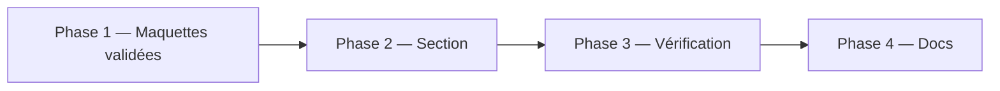
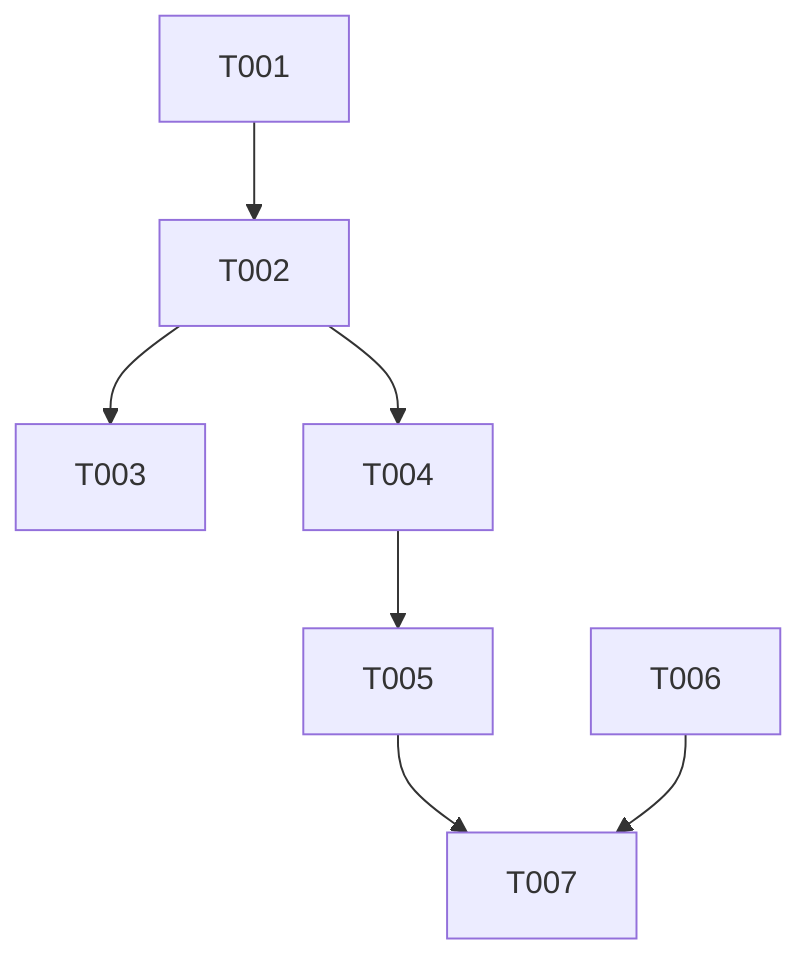

# Plan d'implémentation — Section Projets en scènes

Statut : livré sur la branche, en attente de validation d'Alex (plan rédigé après coup)
Couvre : PRD F-02 à F-06, F-16, F-17 ; NF-07, NF-10 ; TRD T-09 à T-11, T-16, T-17
Branche : `feature/projets-scenes` (depuis `dev`). Merge sur `dev` en `--no-ff` après accord d'Alex.

## 1. Objectif du lot

Remplacer le scrollytelling GSAP de la section Projets par une scène plein écran par projet : le contenu ne bouge pas, les informations apparaissent sur place, le fond de points indique la progression du projet. Le menu des projets passe à gauche, avec une barre de section et une vue latérale sous 48rem. Hero et CV ne sont pas touchés.

## 2. Décisions préalables

| # | Question | Décision | Raison |
|---|---|---|---|
| 1 | Style de la scène | « Dossier » : aperçu dans un cadre de navigateur, grille 5/7 | Choix d'Alex après comparaison de 3 maquettes (Planche, Affiche, Dossier) |
| 2 | Que mesure l'indicateur ? | Un fond de points, par projet, qui s'allume en cercle depuis l'aperçu | Alex : l'indicateur est par projet, le fond lui sert ; aucun visuel de descente dans un projet |
| 3 | Menu | Fixe à gauche dès 48rem ; barre de section et vue latérale (moitié de l'écran) en dessous | Alex : menu rattaché à la section, pas au cadre du projet ; vue plus propre qu'une pop |
| 4 | Bibliothèque d'animation | Aucune : `sticky`, canvas 2D, transitions CSS | Moins de dépendances (3 scripts CDN en moins), pas de bug de pin |
| 5 | Écran trop bas | Repli en lecture normale (`is-flow`) plutôt que de couper le bas | Constaté à 1024×768 et 700×340 |
| 6 | Périmètre | Section Projets seulement : hero et CV inchangés ; seuls le template (3 scripts GSAP) et le commentaire de la CSP sont touchés hors section | Demande d'Alex |

## 3. Phases

## 4. Tâches

Aucun fichier `docs/tasks/` : le travail a été mené directement en session, sans délégation. Les tâches ci-dessous servent de suivi.

| ID | Tâche | Story | Fichiers cibles | Dépend de | [P] | Statut |
|---|---|---|---|---|---|---|
| T001 | Liens Safe Campus vers les dépôts `Korrighed` | US-03 | `src/sections/projets.html`, `public/index.html` | — | | fait |
| T002 | Markup : 5 scènes, menu, barre, vue latérale, canvas | US-01, US-10 | `src/sections/projets.html` | T001 | | fait |
| T003 | CSS : scènes, grille, menu, mobile, repli | US-01, US-10, US-11 | `public/css/projets.css` | T002 | | fait |
| T004 | JS : progression, apparition, fond de points, menu, vue latérale, mesure `is-flow` | US-01, US-10, US-11 | `public/js/projets-scroll.js` | T002 | [P] avec T003 | fait |
| T005 | Retrait des 3 scripts GSAP, commentaire CSP | — | `src/index.template.html`, `netlify.toml` | T004 | | fait |
| T006 | Aperçus provisoires | US-02 | `public/img/projets/` | — | [P] | fait (à remplacer) |
| T007 | Mise à jour des docs | — | `docs/*.md` | T005 | | fait |

## 5. Graphe de dépendances

## 6. Vérification du lot

| Contrôle | Commande / méthode | Attendu |
|---|---|---|
| Lint | Aucun outil en place | — |
| Build | `npm run build` | `public/index.html` généré, aucune trace de GSAP |
| Syntaxe JS | `node --check public/js/projets-scroll.js` | 0 erreur |
| Parcours | `APP-FLOW.md` §2, navigateur headless | Voir tableau ci-dessous |

Mesures en navigateur headless (Playwright), à 95 % de progression de chaque projet :

| Écran | Résultat |
|---|---|
| 1280×720 | 5 projets épinglés, contenu de 64 à 680 px sur 720, aucun débordement |
| 1366×768 | 5 projets épinglés, tout tient |
| 1920×1080 | Rendu cohérent (capture) |
| 1024×768 | 5 projets en lecture normale (disposition en colonne) |
| 390×844 | 5 projets, contenu de 56 à 820 px sur 844 |
| 375×667 | 5 projets tiennent, compactage du texte |
| 360×560 | 5 projets tiennent, aperçu réduit au minimum |
| 700×340 (paysage) | 5 projets en lecture normale, tout visible, aucun défilement horizontal |

Non vérifié : appareils réels, encoche (marges prévues dans le CSS), performance du canvas sur appareil modeste, CSP sous `netlify dev` (aucune nouvelle origine, mais pas rejouée), lecteurs d'écran.

## 7. Risques

| Risque | Probabilité | Impact | Parade |
|---|---|---|---|
| `scroll-behavior: smooth` global + `sticky` : saut sur certains navigateurs | Faible | Moyen | Tester Safari et Firefox avant la mise en ligne |
| Canvas lent sur appareil modeste | Faible | Faible | Boucle pausée hors section ; réduire l'espacement ou le nombre de points |
| Textes provisoires « [période à préciser] » visibles dans les scènes | Certaine | Faible | PRD F-15 : à remplacer par Alex |
| Captures provisoires, Safe Campus sans aperçu | Certaine | Faible | Alex fournit des captures ; garder les noms de fichier |

## 8. Suivi

| Tâche | Commit | Vérifié le | Remarque |
|---|---|---|---|
| T001 | `12062e3` | 2026-10-31 | Liens régénérés dans `public/index.html` |
| T002 à T006 | `755a111` | 2026-10-31 | Mesures du §6 |
| T007 | commit suivant de la branche | 2026-10-31 | PRD, TRD, DESIGN-BRIEF, APP-FLOW, ce plan |
