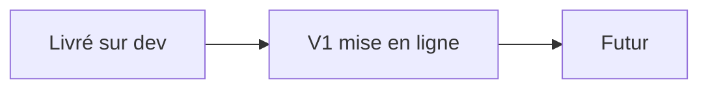

# PRD — Portfolio d'Alex

Statut : brouillon
Sources : `README.md`, code de `dev` (cfa2a50), `docs/reports/2026-10-26-constats.md`, réponses d'Alex du 2026-10-26.

Ce document décrit l'état **cible** du site. Le site est en construction : les exigences marquées « à livrer » ne sont pas encore en place. Les autres sont livrées sur `dev`.

## 1. Problème

Alex, développeur full stack, n'a pas de vitrine publique de ses projets, de ses compétences et de son CV. Un recruteur ou un client doit pouvoir juger son travail en quelques minutes, sans lire du code. Par ailleurs, un enseignant doit consulter des fiches réflexives (PDF) qui ne doivent pas être publiques. Le site répond aux deux besoins : une partie publique soignée et un espace privé minimal à compte unique.

## 2. Objectifs

| ID | Objectif | Mesure de succès |
|---|---|---|
| O-01 | Présenter les 5 projets de façon lisible et mémorable | Chaque projet affiche synopsis, stack, points clés, liens et un aperçu animé |
| O-02 | Donner accès aux moyens de contact | GitHub est à un clic ; le CV reste hors ligne et le formulaire de contact viendra plus tard (l'adresse email n'est jamais affichée) |
| O-03 | Donner à l'enseignant un accès privé aux fiches réflexives | Sans session, aucune fiche ni aucun PDF n'est servi |
| O-04 | Rester maintenable seul | Ajouter un projet ou une fiche ne demande aucun outil hors dépôt et CLI Netlify |

## 3. Non-objectifs

- Pas de base de données.
- Pas de comptes multiples : un seul compte enseignant.
- Pas de back-office ni de CMS.
- Pas de framework de rendu (HTML/CSS/JS vanilla).
- Pas de pages détail par projet : les aperçus vivent dans la section Projets de l'accueil (voir Questions ouvertes pour `public/projets/`).

## 4. Utilisateurs

| Persona | Contexte | Besoin principal |
|---|---|---|
| Visiteur (recruteur, client, pair) | Arrive par un lien, desktop ou mobile, peu de temps | Comprendre vite ce qu'Alex sait faire et le contacter |
| Enseignant | Se connecte avec un code d'accès unique fourni par Alex | Lire les fiches réflexives sans friction |
| Alex (mainteneur) | Développe seul, déploie sur Netlify | Modifier le contenu sans casser le site |

## 5. User stories

| ID | En tant que | Je veux | Afin de | Priorité (P1 = MVP) |
|---|---|---|---|---|
| US-01 | Visiteur | parcourir les projets un par un | voir leur contexte, leur stack et leurs points clés | P1 |
| US-02 | Visiteur | voir une vidéo ou un gif de démo de chaque projet | comprendre le résultat sans ouvrir le site | P1 |
| US-03 | Visiteur | ouvrir le dépôt GitHub et le site en ligne d'un projet | vérifier le code et tester le produit | P1 |
| US-04 | Visiteur | lire les réponses aux questions fréquentes sur le profil d'Alex | situer le profil | P1 |
| US-05 | Visiteur | télécharger le CV | le transmettre ou l'archiver | reporté (le CV reste en local) |
| US-06 | Visiteur | contacter Alex | engager un échange | reporté (formulaire à venir ; GitHub en attendant) |
| US-07 | Enseignant | me connecter | accéder à l'espace privé | P1 |
| US-08 | Enseignant | parcourir les fiches par titre et voir leurs compétences | évaluer chaque projet, puis ouvrir le PDF | P1 |
| US-09 | Enseignant | me déconnecter | fermer ma session | P1 |
| US-10 | Visiteur mobile | atteindre n'importe quel projet sans tout faire défiler | gagner du temps | P2 |
| US-11 | Visiteur sensible au mouvement | un site sans animation imposée | lire sans gêne | P2 |
| US-12 | Alex | ajouter une fiche PDF sans redéployer le front | rester autonome | P2 |

## 6. Exigences fonctionnelles

Statut : **livré** ou **à livrer**.

| ID | Exigence | User story | Critère d'acceptation | Statut |
|---|---|---|---|---|
| F-01 | Barre de navigation : logo et marque « korrighed.dev », ancres Projets et Questions, lien GitHub (logo monochrome et « /Korrighed », nouvel onglet), lien Espace enseignant ; menu repliable sous 48rem | US-04, US-07 | AC-01 : Étant donné un écran < 48rem, quand je touche le bouton de menu, alors les liens s'affichent et `aria-expanded` vaut `true` | livré |
| F-02 | Hero avec bouton « Projets » menant au projet 1 (ancre `#projets`, défilement lisse du navigateur) ; deux blocs de texte placés en position absolue par quatre classes que seul Alex modifie (`hero-pos-desktop-1` et `-2` dès 48rem, `hero-pos-mobile-1` et `-2` en dessous), tailles de texte fluides | US-01 | AC-02 : Quand je clique le bouton, alors la page défile jusqu'à la scène du projet 1 ; aux positions choisies par Alex (2026-11-01), à 1920×1080, 1280×720, 1024×768, 768×1024, 390×844, 320×568 et 844×390, aucun texte du hero ne se chevauche, ne sort de l'écran ni ne touche le bouton | livré (branche `feature/distribution-netlify-pdf`) |
| F-03 | Section Projets : une scène plein écran par projet ; le contenu ne bouge pas, les informations (titre, tags, aperçu, résumé, points clés, liens) apparaissent sur place selon la progression du défilement dans le projet ; aucune bibliothèque d'animation | US-01, US-03 | AC-03 : Étant donné une scène épinglée, quand je défile, alors les informations apparaissent dans l'ordre de lecture, puis la scène se libère. Sur mobile, l'aperçu apparaît avant le titre | livré (branche `feature/projets-scenes`) |
| F-04 | Menu des projets : fixe à gauche dès 48rem, visible tant que la section est à l'écran, projet en cours marqué ; clic = scène entièrement révélée ; premier lien « Accueil » (retour au hero) et dernier lien « QA » vers la section Questions (pas de lien « Suite » dans les scènes) ; la vue latérale mobile ajoute « Espace enseignant » après « QA » | US-01, US-06 | AC-04 : Quand je clique un titre, alors la scène s'affiche avec ses liens sans défilement manuel supplémentaire | livré (branche `feature/projets-scenes`) |
| F-05 | Chaque scène affiche un aperçu média dans un cadre de navigateur dont la barre d'adresse est le lien du site | US-02 | AC-05 : Étant donné la scène d'un projet, quand elle est visible, alors son aperçu est affiché et chargé en différé | livré : GIF Twitch ; vidéos MP4 (bureau + mobile) pour GW2, Hyperloop, Dice Roller, Safe Campus |
| F-06 | Le fond de la section est l'indicateur de progression du projet : un cercle de points lumineux part de l'aperçu et grandit avec le défilement, remis à zéro à chaque projet | US-01 | AC-06 : À 0 % seul l'aperçu est entouré de points ternes ; à 100 % tout l'écran est allumé ; rien ne descend dans la scène | livré (branche `feature/projets-scenes`) |
| F-07 | Section Questions fréquentes : 5 questions sur le profil d'Alex, rendues depuis `src/data/faq.json` (même source pour le HTML et pour les données structurées `FAQPage`) ; onglets au clavier et à la souris ; sans JavaScript les 5 réponses restent lisibles à la suite | US-04 | AC-07 : Étant donné l'accueil, alors la section affiche 5 questions avec leur réponse et `public/index.html` contient un bloc `application/ld+json` de 5 `Question` | à livrer |
| F-08 | Section CV retirée du site : le CV reste en local | US-05 | AC-08 : `public/index.html` ne contient ni `id="cv"` ni lien vers un PDF de CV | à livrer |
| F-09 | Pied de page : GitHub et lien Espace enseignant ; aucune adresse email | US-06 | AC-09 : Le pied de page contient ces deux liens et aucun `mailto:` | à livrer |
| F-10 | Connexion par code d'accès seul (pas d'identifiant), lu en clair dans la variable `AUTH_CODE` : `POST /api/login` ; succès vers `/fiches-reflexives`, échec vers `/login.html?error=1` avec message ; après 5 échecs depuis la même adresse, refus pendant 15 minutes (`/login.html?error=2`) | US-07 | AC-10 : Étant donné un mauvais code, quand je valide, alors « Code incorrect. » s'affiche | livré |
| F-11 | Page des fiches (protégée) : une scène sombre à onglets, le titre de chaque fiche dans le menu | US-08 | AC-11 : Sans session, alors redirection vers `/login.html` ; avec session, trois onglets et trois panneaux | à livrer |
| F-12 | Panneau d'une fiche : sous-titre, compétences visées, livrables, statut, date, liens et lien vers le PDF ; l'ancienne page de détail redirige vers la liste | US-08 | AC-12 : Un `id` inconnu renvoie 404 sur `/fiches-reflexives/:id` ; un `id` connu redirige vers `/fiches-reflexives` | à livrer |
| F-13 | Service du PDF réservé aux sessions valides | US-08 | AC-13 : Sans session, `GET /api/pdf/:id` renvoie 401 | livré |
| F-14 | Déconnexion : `POST /api/logout` détruit le cookie et renvoie à `/` | US-09 | AC-14 : Après déconnexion, `/fiches-reflexives` redirige vers le login | livré |
| F-15 | Aucun texte provisoire visible, et aucune période mentionnée dans les résumés de projet | US-01 | AC-15 : Aucune occurrence de « période » dans `public/index.html` | livré (branche `feature/distribution-netlify-pdf`) |
| F-16 | Sous `prefers-reduced-motion`, aucun épinglage ni révélation progressive : le contenu des scènes est lisible d'emblée. Même repli si la scène ne tient pas dans l'écran (petit mobile, paysage, zoom) | US-11 | AC-16 : Étant donné la préférence activée, ou un écran trop bas, alors tout le contenu de chaque projet est visible sans scène épinglée | livré (branche `feature/projets-scenes`) |
| F-17 | Sous 48rem : barre de section « Projets \| projet en cours » au-dessus du projet, et menu en vue latérale (moitié de l'écran, pleine hauteur, fond plein, reste assombri) | US-10 | AC-17 : Étant donné un écran < 48rem, alors un bouton visible ouvre la liste des projets ; un clic sur un projet ferme la vue et défile ; `Esc` la ferme | livré (branche `feature/projets-scenes`) |
| F-18 | Ajout d'une fiche : PDF déposé dans le store Blobs puis entrée ajoutée à la liste des fiches | US-12 | AC-18 : Après dépôt et déploiement, la fiche apparaît dans la liste et son PDF s'ouvre | livré (procédure à documenter) |
| F-19 | La section Questions tient dans un seul écran : une question choisie à la fois, sa réponse change sur place sans décalage ; fond de points très pâle et fixe, avec une onde légère partant du bloc de réponse à chaque changement de question (aucun point sous le texte) | US-04 | AC-19 : Étant donné 1280×720, 1024×768 et 390×844, alors la section mesure la hauteur de l'écran, une seule réponse est visible, la changer ne déplace rien, aucun point ne passe sous le texte ; sous `prefers-reduced-motion`, la grille est fixe et il n'y a pas d'onde | à livrer |
| F-20 | La page des fiches reprend la scène de la FAQ en thème sombre (fond Ink Black, texte Platinum, accent Powder Blue), même fond de points et même onde, sans décalage au changement de fiche | US-08 | AC-20 : Étant donné 1280×720, 1024×768 et 390×844, alors une seule fiche est visible, en changer ne déplace rien, aucun point ne passe sous le texte ; la FAQ de l'accueil reste en thème clair | à livrer |
| F-21 | La connexion enseignant se fait dans une fenêtre sombre ouverte sur l'accueil par le lien « Espace enseignant » (barre et pied de page) : champ « Code d'accès », erreur affichée dans la fenêtre, succès vers `/fiches-reflexives` ; sans JavaScript, le lien mène à `/login.html` | US-07 | AC-21 : Étant donné l'accueil, quand je clique « Espace enseignant », alors une fenêtre s'ouvre avec le focus dans le champ ; un code faux affiche « Code incorrect. » sans quitter la page ; `Échap` ou un clic sur le fond la ferme | à livrer |
| F-22 | La page des fiches s'ouvre entre un en-tête clair (marque « korrighed.dev », Accueil, Se déconnecter) et un pied de page clair ; le lien vers le PDF est un grand bouton plein sous le sous-titre de chaque fiche, l'action principale de la page ; le logo de l'IUT précède la mention « Espace enseignant » (page des fiches et fenêtre de connexion) ; la page s'adapte du mobile au grand écran | US-08 | AC-22 : Étant donné 1280×720 et 1024×768, alors en-tête, scène et pied de page tiennent dans l'écran ; à 320 px, aucun débordement horizontal ; le bouton « Ouvrir la fiche réflexive » ouvre `/api/pdf/:id` dans un nouvel onglet | livré (branche `feature/distribution-netlify-pdf`) |
| F-23 | Page « Mentions légales » (`/mentions-legales.html`) : éditeur, hébergeur, propriété intellectuelle, données personnelles et cookies, liens externes ; liée depuis les pieds de page de l'accueil et de l'espace enseignant ; aucune adresse email | US-06 | AC-23 : Étant donné un pied de page, alors le lien « Mentions légales » ouvre la page, qui contient cinq sections et aucun `mailto:` | livré (texte à relire par Alex) |
| F-24 | Chaque tag de technologie des projets est précédé du logo de la technologie, en couleurs d'origine, à 14 px, décoratif (le nom reste écrit) ; aucun logo générique pour les technologies sans logo (AG Grid, React Three Fiber) | US-02 | AC-24 : Étant donné la section Projets, alors 19 des 21 tags portent un logo qui se charge (statut 200) et aucun logo ne déborde de l'écran à 390 px | livré (branche `feature/distribution-netlify-pdf`) |

## 7. Exigences non fonctionnelles

| ID | Catégorie | Exigence mesurable | Statut |
|---|---|---|---|
| NF-01 | Sécurité | Cookie de session `HttpOnly`, `SameSite=Lax`, durée 8 h, `Secure` sur tout déploiement HTTPS (production, deploy-previews, branch deploys) | livré (à vérifier sur un deploy-preview) |
| NF-02 | Robustesse | Aucune entrée malformée (cookie mal encodé, corps de POST sans champ) ne produit un code 500 | à livrer |
| NF-03 | Sécurité | Les tentatives de connexion sont limitées : 5 échecs par adresse IP bloquent la connexion 15 minutes, même avec le bon code ; un succès remet le compteur à zéro | livré (branche `feature/code-acces-limite-tentatives`) ; compteur à valider sur Blobs réel |
| NF-04 | Sécurité | Toutes les routes, pages statiques et réponses des fonctions, portent `X-Content-Type-Options`, `Referrer-Policy`, une protection anti-cadrage, `Permissions-Policy` et une CSP ; pages protégées et PDF portent `Cache-Control: private, no-store` | livré (branche `feature/securite-en-tetes`) ; CSP des fonctions vérifiée dans Edge : 0 violation sur la page des fiches ; à contrôler en ligne après le premier déploiement |
| NF-05 | Sécurité | Aucun script ni style n'est chargé depuis un tiers ni écrit en ligne : Three.js et Vanta sont hébergés dans `public/vendor/` (versions exactes dans `LICENSES.md`), la CSP est `script-src 'self'; style-src 'self'` | livré (branche `feature/securite-en-tetes`) |
| NF-06 | Performance | Les médias de démo se chargent en différé et ne bloquent pas le premier affichage ; budget de poids par média à fixer | à livrer |
| NF-07 | Accessibilité | Texte ≥ 4.5:1, éléments d'interface ≥ 3:1 ; focus visible partout ; une information non révélée n'est pas atteignable au clavier (`inert`) | partiel (section Projets traitée, voir `DESIGN-BRIEF.md`) |
| NF-08 | Compatibilité | Utilisable sur desktop et mobile ; ruptures à 48rem et 64rem ; navigateurs récents (usage de `color-mix`) | livré |
| NF-09 | Référencement | `title` et `meta description` propres, Open Graph, favicon, données structurées `FAQPage` ; `noindex` sur login, fiches et API | partiel : titre, description, Open Graph (dont `og:site_name`), `theme-color`, favicon, FAQPage, `noindex` sur login, fiches et API, `robots.txt` ; `og:image` (capture du hero, 1200×630, `public/img/og-image.png`) ; pas de `twitter:card` (Alex n'a pas de compte) ; `canonical`, `og:url`, `sitemap.xml` et `robots.txt` suivent la variable `SITE_URL` (défaut `https://kaporfolio.netlify.app`) |
| NF-10 | Dégradation | Si Vanta ne se charge pas, le contenu reste lisible ; aucune section ne dépend d'un CDN et la section Projets reste lisible sans JavaScript | livré (garde `typeof VANTA` dans `hero-vanta.js`) |
| NF-11 | Confidentialité | Aucun PDF de fiche dans le dépôt ni sous `public/` ; accès uniquement par la fonction protégée | livré |
| NF-12 | Démarrage local | `npm run dev` rend la main en moins de 15 s sur le poste d'Alex, connexion Netlify valide ou non | partiel : `npx` retiré ; reste environ 9 s de démarrage du CLI avec session expirée |
| NF-13 | Confidentialité | L'adresse email d'Alex n'apparaît dans aucun fichier servi (`public/`, `src/`, JavaScript, données structurées) | à livrer |

## 8. Contraintes

| ID | Contrainte | Origine |
|---|---|---|
| C-01 | Compte unique, pas de base de données | Décision d'Alex (README) |
| C-02 | Hébergement Netlify : Functions et Blobs | Technique |
| C-03 | HTML/CSS/JS vanilla, pas de framework de rendu | Décision d'Alex (commit 42681f8) |
| C-04 | Palette de 4 couleurs et grille suisse | Décision d'Alex, voir `DESIGN-BRIEF.md` |
| C-05 | `public/index.html` est généré : ne jamais l'éditer à la main | Technique (`scripts/build-index.js`) |
| C-06 | Site en construction : CV et médias définitifs arrivent plus tard (les périodes des projets ne seront pas affichées) | Alex, 2026-10-26 et 2026-11-01 |

## 9. Périmètre par version

| Version | Contenu (IDs) |
|---|---|
| Livré | F-01, F-02, F-07, F-09 à F-14, F-18 ; NF-08, NF-11 |
| Livré sur `feature/projets-scenes`, à merger après validation | F-03, F-04, F-06, F-16, F-17 |
| V1 mise en ligne | F-05 (aperçus définitifs), F-08, F-15 ; NF-01 à NF-07, NF-09, NF-10, NF-12 |
| Futur | Aucun élément décidé |

## 10. Questions ouvertes

- Médias de démo : quel format (mp4, webm, gif), quelle durée maximale, quel poids maximal par fichier ? Recommandation : webm/mp4 muet en boucle sous 2 Mo, gif exclu.
- Où stocker ces médias : dans le dépôt (`public/media/`) ou hors dépôt ? Recommandation : dans le dépôt tant que le total reste modeste.
- Aperçus : le GIF Twitch (1,7 Mo) pourrait passer en MP4 comme les autres. La barre du cadre de Safe Campus pointe vers le dépôt front, le site en ligne étant protégé par un code d'accès.
- `public/projets/` (gabarits vides, non liés) : je les classe hors périmètre et à supprimer avant la V1. À confirmer.
- CV et contact : le CV reste en local ; le formulaire de contact (adresse jamais affichée) sera traité dans un lot ultérieur.
- Formulaire de contact ou statistiques de visite : souhaités un jour ? Aucun n'est prévu pour l'instant.
