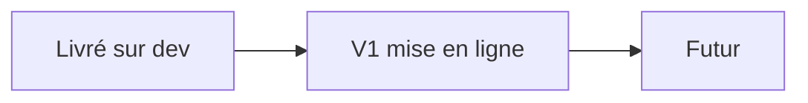

# PRD — Portfolio d'Alex

Statut : brouillon
Sources : `README.md`, code de `dev` (cfa2a50), `docs/reports/2026-10-26-constats.md`, réponses d'Alex du 2026-10-26.

Ce document décrit l'état **cible** du site. Le site est en construction : les exigences marquées « à livrer » ne sont pas encore en place. Les autres sont livrées sur `dev`.

## 1. Problème

Alex, développeur full stack, n'a pas de vitrine publique de ses projets, de ses compétences et de son CV. Un recruteur ou un client doit pouvoir juger son travail en quelques minutes, sans lire du code. Par ailleurs, un enseignant doit consulter des fiches réflexives (PDF) qui ne doivent pas être publiques. Le site répond aux deux besoins : une partie publique soignée et un espace privé minimal à compte unique.

## 2. Objectifs

| ID | Objectif | Mesure de succès |
|---|---|---|
| O-01 | Présenter les 5 projets de façon lisible et mémorable | Chaque projet affiche synopsis, stack, points clés, liens et un aperçu animé |
| O-02 | Donner accès au CV et aux moyens de contact | Le CV se télécharge ; l'email et GitHub sont à un clic |
| O-03 | Donner à l'enseignant un accès privé aux fiches réflexives | Sans session, aucune fiche ni aucun PDF n'est servi |
| O-04 | Rester maintenable seul | Ajouter un projet ou une fiche ne demande aucun outil hors dépôt et CLI Netlify |

## 3. Non-objectifs

- Pas de base de données.
- Pas de comptes multiples : un seul compte enseignant.
- Pas de back-office ni de CMS.
- Pas de framework de rendu (HTML/CSS/JS vanilla).
- Pas de pages détail par projet : les aperçus vivent dans la section Projets de l'accueil (voir Questions ouvertes pour `public/projets/`).

## 4. Utilisateurs

| Persona | Contexte | Besoin principal |
|---|---|---|
| Visiteur (recruteur, client, pair) | Arrive par un lien, desktop ou mobile, peu de temps | Comprendre vite ce qu'Alex sait faire et le contacter |
| Enseignant | Se connecte avec un identifiant unique fourni par Alex | Lire les fiches réflexives sans friction |
| Alex (mainteneur) | Développe seul, déploie sur Netlify | Modifier le contenu sans casser le site |

## 5. User stories

| ID | En tant que | Je veux | Afin de | Priorité (P1 = MVP) |
|---|---|---|---|---|
| US-01 | Visiteur | parcourir les projets un par un | voir leur contexte, leur stack et leurs points clés | P1 |
| US-02 | Visiteur | voir une vidéo ou un gif de démo de chaque projet | comprendre le résultat sans ouvrir le site | P1 |
| US-03 | Visiteur | ouvrir le dépôt GitHub et le site en ligne d'un projet | vérifier le code et tester le produit | P1 |
| US-04 | Visiteur | lire les compétences et technologies | situer le profil | P1 |
| US-05 | Visiteur | télécharger le CV | le transmettre ou l'archiver | P1 |
| US-06 | Visiteur | contacter Alex | engager un échange | P1 |
| US-07 | Enseignant | me connecter | accéder à l'espace privé | P1 |
| US-08 | Enseignant | lister puis ouvrir une fiche | lire le PDF | P1 |
| US-09 | Enseignant | me déconnecter | fermer ma session | P1 |
| US-10 | Visiteur mobile | atteindre n'importe quel projet sans tout faire défiler | gagner du temps | P2 |
| US-11 | Visiteur sensible au mouvement | un site sans animation imposée | lire sans gêne | P2 |
| US-12 | Alex | ajouter une fiche PDF sans redéployer le front | rester autonome | P2 |

## 6. Exigences fonctionnelles

Statut : **livré** ou **à livrer**.

| ID | Exigence | User story | Critère d'acceptation | Statut |
|---|---|---|---|---|
| F-01 | Barre de navigation : ancres Projets, Compétences, CV, lien Espace enseignant ; menu repliable sous 48rem | US-04, US-07 | AC-01 : Étant donné un écran < 48rem, quand je touche le bouton de menu, alors les liens s'affichent et `aria-expanded` vaut `true` | livré |
| F-02 | Hero avec bouton « Projets » menant à la carte 1, première étape déjà révélée | US-01 | AC-02 : Quand je clique le bouton, alors la page défile vers la carte 1 et la première étape apparaît pendant le trajet | livré |
| F-03 | Section Projets : 5 cartes plein écran épinglées ; les étapes (sous-titre, tags, synopsis, points clés, liens) se révèlent au défilement | US-01, US-03 | AC-03 : Étant donné une carte épinglée, quand je défile, alors les 5 étapes apparaissent dans l'ordre puis la carte se libère | livré |
| F-04 | Menu latéral des projets, visible tant que la section est à l'écran ; clic = carte entièrement révélée ; dernier lien « Me contacter » vers le pied de page | US-01, US-06 | AC-04 : Quand je clique un titre, alors la carte s'affiche avec ses liens sans défilement manuel supplémentaire | livré |
| F-05 | Chaque carte affiche un aperçu média (vidéo ou gif) dans l'emplacement réservé | US-02 | AC-05 : Étant donné la carte d'un projet, quand elle est visible, alors son média se lit en boucle, muet, sans bloquer le défilement | à livrer |
| F-06 | Barre de progression en onde animée par carte | US-01 | AC-06 : La largeur remplie suit l'avancement des étapes | livré |
| F-07 | Section Compétences : liste de compétences et technologies groupées Front / Back / Outils | US-04 | AC-07 : Les trois groupes s'affichent ; sous 48rem ils s'empilent | livré |
| F-08 | Section CV avec lien de téléchargement PDF | US-05 | AC-08 : Quand je clique le lien, alors le PDF se télécharge (pas de 404) | à livrer (fichier absent) |
| F-09 | Pied de page : email, GitHub, lien Espace enseignant | US-06 | AC-09 : Les trois liens sont présents et fonctionnent | livré |
| F-10 | Connexion : `POST /api/login` ; succès vers `/fiches-reflexives`, échec vers `/login.html?error=1` avec message | US-07 | AC-10 : Étant donné de mauvais identifiants, quand je valide, alors « Identifiants incorrects. » s'affiche | livré |
| F-11 | Liste des fiches (page protégée) | US-08 | AC-11 : Sans session, alors redirection vers `/login.html` | livré |
| F-12 | Détail d'une fiche avec lien vers le PDF | US-08 | AC-12 : Un `id` inconnu renvoie 404 | livré |
| F-13 | Service du PDF réservé aux sessions valides | US-08 | AC-13 : Sans session, `GET /api/pdf/:id` renvoie 401 | livré |
| F-14 | Déconnexion : `POST /api/logout` détruit le cookie et renvoie à `/` | US-09 | AC-14 : Après déconnexion, `/fiches-reflexives` redirige vers le login | livré |
| F-15 | Aucun texte provisoire visible (« [période à préciser] ») | US-01 | AC-15 : Aucune occurrence de `[` suivi de « période » dans `public/index.html` | à livrer |
| F-16 | Sous `prefers-reduced-motion`, aucun épinglage ni révélation progressive : le contenu des cartes est lisible d'emblée | US-11 | AC-16 : Étant donné la préférence activée, alors les 5 étapes de chaque carte sont visibles sans défilement épinglé | à livrer |
| F-17 | Substitut mobile au menu latéral pour atteindre un projet | US-10 | AC-17 : Étant donné un écran < 48rem, alors un moyen visible permet de sauter à un projet | à livrer |
| F-18 | Ajout d'une fiche : PDF déposé dans le store Blobs puis entrée ajoutée à la liste des fiches | US-12 | AC-18 : Après dépôt et déploiement, la fiche apparaît dans la liste et son PDF s'ouvre | livré (procédure à documenter) |

## 7. Exigences non fonctionnelles

| ID | Catégorie | Exigence mesurable | Statut |
|---|---|---|---|
| NF-01 | Sécurité | Cookie de session `HttpOnly`, `SameSite=Lax`, durée 8 h, `Secure` sur tout déploiement HTTPS (production, deploy-previews, branch deploys) | livré (à vérifier sur un deploy-preview) |
| NF-02 | Robustesse | Aucune entrée malformée (cookie mal encodé, corps de POST sans champ) ne produit un code 500 | à livrer |
| NF-03 | Sécurité | Les tentatives de connexion sont limitées (seuil à fixer, voir Questions ouvertes) | à livrer |
| NF-04 | Sécurité | Toutes les routes portent `X-Content-Type-Options`, `Referrer-Policy`, une protection anti-cadrage et une CSP ; pages protégées et PDF portent `Cache-Control: private, no-store` | partiel : en-têtes et cache livrés, CSP à valider dans un navigateur |
| NF-05 | Sécurité | Chaque script CDN a une version exacte et un attribut `integrity` | à livrer |
| NF-06 | Performance | Les médias de démo se chargent en différé et ne bloquent pas le premier affichage ; budget de poids par média à fixer | à livrer |
| NF-07 | Accessibilité | Texte ≥ 4.5:1, éléments d'interface ≥ 3:1 ; focus visible partout ; une étape non révélée n'est pas atteignable au clavier | partiel (voir `DESIGN-BRIEF.md`) |
| NF-08 | Compatibilité | Utilisable sur desktop et mobile ; ruptures à 48rem et 64rem ; navigateurs récents (usage de `color-mix`) | livré |
| NF-09 | Référencement | `title` et `meta description` propres, Open Graph, favicon ; `noindex` sur login, fiches et API | à livrer |
| NF-10 | Dégradation | Si GSAP ou Vanta ne se charge pas, le contenu reste lisible | partiel (garde GSAP présente, pas de garde Vanta) |
| NF-11 | Confidentialité | Aucun PDF de fiche dans le dépôt ni sous `public/` ; accès uniquement par la fonction protégée | livré |
| NF-12 | Démarrage local | `npm run dev` rend la main en moins de 15 s sur le poste d'Alex, connexion Netlify valide ou non | partiel : `npx` retiré ; reste environ 9 s de démarrage du CLI avec session expirée |

## 8. Contraintes

| ID | Contrainte | Origine |
|---|---|---|
| C-01 | Compte unique, pas de base de données | Décision d'Alex (README) |
| C-02 | Hébergement Netlify : Functions et Blobs | Technique |
| C-03 | HTML/CSS/JS vanilla, pas de framework de rendu | Décision d'Alex (commit 42681f8) |
| C-04 | Palette de 4 couleurs et grille suisse | Décision d'Alex, voir `DESIGN-BRIEF.md` |
| C-05 | `public/index.html` est généré : ne jamais l'éditer à la main | Technique (`scripts/build-index.js`) |
| C-06 | Site en construction : CV, périodes et médias arrivent plus tard | Alex, 2026-10-26 |

## 9. Périmètre par version

| Version | Contenu (IDs) |
|---|---|
| Livré | F-01 à F-04, F-06, F-07, F-09 à F-14, F-18 ; NF-08, NF-11 |
| V1 mise en ligne | F-05, F-08, F-15, F-16, F-17 ; NF-01 à NF-07, NF-09, NF-10, NF-12 |
| Futur | Aucun élément décidé |

## 10. Questions ouvertes

- Médias de démo : quel format (mp4, webm, gif), quelle durée maximale, quel poids maximal par fichier ? Recommandation : webm/mp4 muet en boucle sous 2 Mo, gif exclu.
- Où stocker ces médias : dans le dépôt (`public/media/`) ou hors dépôt ? Recommandation : dans le dépôt tant que le total reste modeste.
- Sous 64rem l'emplacement d'aperçu est masqué : où montrer le média sur mobile et tablette ?
- `public/projets/` (gabarits vides, non liés) : je les classe hors périmètre et à supprimer avant la V1. À confirmer.
- CV : quand le fichier sera prêt, le dépose-t-on dans `public/` (versionné) ou dans Blobs ?
- Limite de tentatives de connexion : quel seuil, et quel mécanisme (Netlify n'offre pas de limiteur dédié aux Functions classiques, à vérifier) ?
- Formulaire de contact ou statistiques de visite : souhaités un jour ? Aucun n'est prévu pour l'instant.
