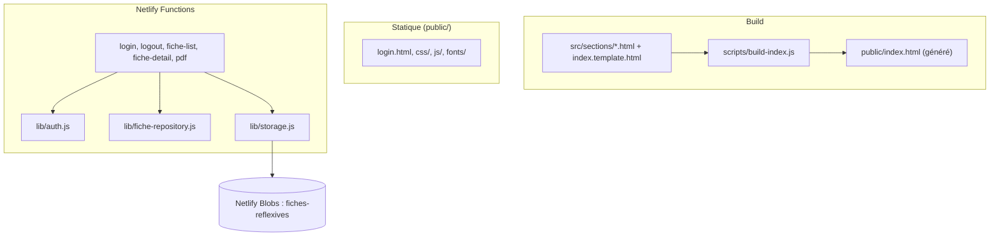
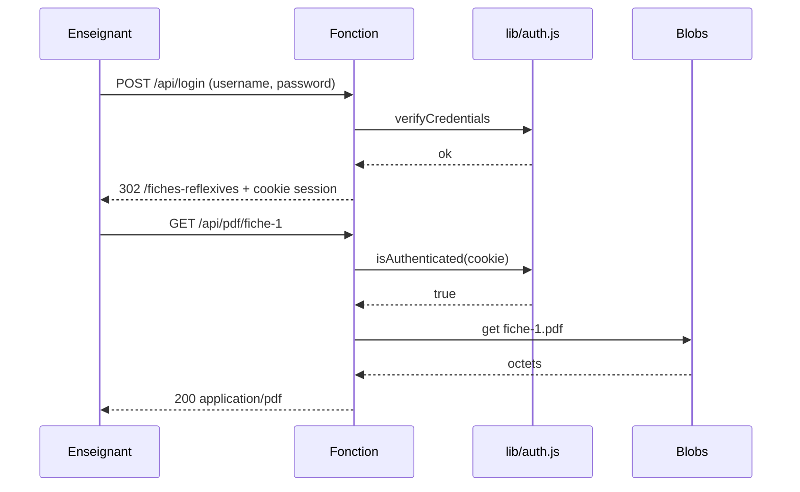

# TRD — Portfolio d'Alex

Statut : brouillon
Couvre : PRD F-01 … F-18, NF-01 … NF-12

## 1. Stack

| Couche | Choix | Version | Raison |
|---|---|---|---|
| Pages | HTML / CSS / JS vanilla | — | Décision C-03 : pas de framework de rendu |
| Assemblage de l'accueil | `scripts/build-index.js` (Node, ESM) | Node 24.14 en local ; version Netlify non épinglée | Découpe de l'accueil en sections |
| Dev local | Vite (HMR) derrière `netlify dev` | 5.4.21 | Rechargement à chaud ; `netlify dev` fournit Functions et redirects |
| CLI | `netlify-cli` | 27.0.1 | Dev local, upload Blobs |
| Back | Netlify Functions classiques (handler `event`) | — | C-02 |
| Session | `iron-session` | ^8.0.0 | Cookie scellé, sans base |
| Mot de passe | `bcryptjs` | ^2.4.3 | Hash du compte unique |
| Fichiers | `@netlify/blobs` | ^10.7.10 | Stockage des PDF hors dépôt |
| Animation | GSAP + ScrollTrigger + ScrollToPlugin, via CDN | 3.15.0 | Scrollytelling des projets |
| Hero | Three.js + Vanta (dots), via CDN | 0.134.0 / 0.5.24 | Fond animé |
| Polices | Libre Caslon Text, Inria Serif (TTF locaux) | — | Voir `DESIGN-BRIEF.md` |

## 2. Architecture

- **Build** : assemble l'accueil. Netlify l'exécute à chaque déploiement (`npm run build`).
- **Statique** : servi tel quel par le CDN Netlify.
- **Functions** : toute la logique protégée. Les redirects de `netlify.toml` exposent des URL propres.
- **Blobs** : seul stockage. Aucune base de données.

## 3. Modules et responsabilités

| Module / dossier | Responsabilité | Dépend de |
|---|---|---|
| `src/index.template.html`, `src/sections/` | Source de l'accueil | — |
| `scripts/build-index.js` | Remplace les marqueurs `<!-- include:… -->` | `src/` |
| `scripts/hash-password.js` | Produit le hash bcrypt à coller dans `.env` | `bcryptjs` |
| `public/js/nav.js` | Menu repliable | DOM |
| `public/js/projets-scroll.js` | Pin, révélation, onde, menu latéral, CTA hero | GSAP (global) |
| `netlify/functions/lib/auth.js` | Identifiants, scellement et lecture du cookie, garde `withAuth` | `iron-session`, `bcryptjs` |
| `netlify/functions/lib/fiche-repository.js` | Liste des fiches (en dur) et recherche par `id` | — |
| `netlify/functions/lib/storage.js` | Lecture d'un PDF dans Blobs | `@netlify/blobs` |
| `netlify/functions/lib/page.js` | Gabarit HTML des pages protégées | — |
| `netlify.toml` | Build, dev, redirects | — |
| `vite.config.js` | Racine `public/`, port 5173 strict, régénération de l'accueil | `scripts/build-index.js` |

## 4. Intégrations externes

| Service | Usage | Auth | Limites, erreurs connues |
|---|---|---|---|
| Netlify Blobs | Lecture des PDF (`getStore('fiches-reflexives')`, `connectLambda(event)`) | Contexte Netlify | Lecture entière en mémoire (pas de stream) ; échec = 404 générique, détail dans les logs |
| jsDelivr | GSAP, Three.js, Vanta | Aucune | Pas de SRI ; CDN indisponible = animations absentes |
| API Netlify (CLI) | Variables d'environnement et état du site au `netlify dev` | Session `netlify login` | Session expirée : appels réseau lents (voir §10) |

## 5. Exigences techniques

| ID | Exigence | Lien PRD | Vérification |
|---|---|---|---|
| T-01 | `parseCookies` ne lève jamais : `decodeURIComponent` dans un `try/catch`, cookie invalide traité comme absent | NF-02 | `curl -H "Cookie: session=%E0%A4%A" /api/pdf/fiche-1` renvoie 401, pas 500 |
| T-02 | `login.js` valide que `username` et `password` sont des chaînes non vides avant `verifyCredentials` | NF-02, F-10 | `curl -X POST /api/login` sans corps renvoie 302 vers `/login.html?error=1` |
| T-03 | Comparaison asynchrone du mot de passe (`bcrypt.compare`) et de l'identifiant en temps constant | NF-03 | Lecture du code ; test T-02 inchangé |
| T-04 | Limitation des tentatives de connexion ; mécanisme à trancher (voir §11) | NF-03 | Après N échecs, réponse refusée pendant une durée donnée |
| T-05 | En-têtes de sécurité via `[[headers]]` dans `netlify.toml` : `X-Content-Type-Options: nosniff`, `Referrer-Policy`, `frame-ancestors` (CSP), CSP complète autorisant jsDelivr | NF-04 | `curl -I` sur `/` et `/login.html` |
| T-06 | `Cache-Control: private, no-store` sur `fiche-list`, `fiche-detail`, `pdf` | NF-04, NF-11 | `curl -I` avec cookie valide |
| T-07 | `Secure` posé dès que la connexion est HTTPS (ne plus dépendre de `CONTEXT === 'production'`), y compris sur le cookie de déconnexion | NF-01 | Test sur un deploy-preview |
| T-08 | Scripts CDN : version exacte conservée, ajout de `integrity` et `crossorigin="anonymous"` | NF-05 | Inspection de `index.template.html` ; console sans erreur SRI |
| T-09 | Médias : balise `<video muted loop playsinline preload="none">` dans `.reel__preview`, lecture déclenchée à l'entrée dans le viewport (IntersectionObserver) | F-05, NF-06 | Onglet Réseau : aucun média chargé avant visibilité |
| T-10 | Sous `prefers-reduced-motion`, `projets-scroll.js` ne crée ni pin ni scrub et laisse les étapes visibles | F-16 | Émulation de la préférence : 5 étapes visibles par carte |
| T-11 | Une étape non révélée est inatteignable au clavier (`visibility: hidden` via `autoAlpha`, ou `inert`) | NF-07 | Parcours Tab : aucun lien invisible focalisé |
| T-12 | Garde sur l'initialisation de Vanta (`typeof VANTA`) et respect de `prefers-reduced-motion` | NF-10 | CDN bloqué : aucune erreur console bloquante |
| T-13 | Échappement HTML des champs interpolés dans `page.js` et `fiche-*.js` | F-11, F-12 | Titre contenant `<` rendu en texte |
| T-14 | `[dev] command` de `netlify.toml` lance Vite sans `npx` ; documenter `netlify login` ou `--offline` | NF-12 | Chronométrer `npm run dev` jusqu'à « Local dev server ready » |
| T-15 | Retirer `PDF_STORAGE_DIR` du `.env` local (variable orpheline depuis la migration Blobs ; absente du dépôt et de `.env.example`) | NF-11 | Le CLI n'affiche plus `PDF_STORAGE_DIR` dans « Injected .env file env vars » |

## 6. Gestion des erreurs et états

| Situation | Comportement attendu |
|---|---|
| Pas de session sur page protégée | 302 vers `/login.html` |
| Pas de session sur `/api/pdf/:id` | 401 |
| Identifiants faux ou champs absents | 302 vers `/login.html?error=1` |
| `id` de fiche inconnu | 404 « Introuvable » |
| PDF absent de Blobs | 404 générique ; détail dans les logs serveur uniquement |
| `SESSION_SECRET` absent ou court | Erreur serveur explicite dans les logs |
| GSAP absent | `projets-scroll.js` se désactive ; les cartes restent lisibles empilées |
| Vanta absent | Fond uni Ink Black (garde à ajouter, T-12) |

## 7. Sécurité et vie privée

- Le mot de passe n'est jamais stocké en clair : hash bcrypt dans `AUTH_PASSWORD_HASH`.
- Le cookie est scellé par `iron-session` ; sa lecture échoue proprement si le secret change.
- `.env` est ignoré par git. `.env.example` donne les noms attendus. Les mêmes variables doivent exister côté Netlify : `SESSION_SECRET`, `AUTH_USERNAME`, `AUTH_PASSWORD_HASH`, `PDF_BLOB_STORE` (optionnel).
- Menaces connues : force brute sur le login (T-04), contenu tiers non vérifié (T-08), mise en cache d'une page protégée par un intermédiaire (T-06), XSS latent si la liste devient dynamique (T-13).

## 8. Qualité

- Lint : aucun outil en place.
- Build : `npm run build`.
- Tests : aucun framework de test.
- Vérification navigateur : passe manuelle ou `qa` sur desktop et mobile (parcours visiteur et parcours enseignant).
- Dev local : `npm run dev`.

## 9. Décisions

| Date | Décision | Alternatives écartées | Raison |
|---|---|---|---|
| 2026-08-02 | Abandon d'Astro pour HTML vanilla + Netlify Functions (42681f8) | Garder Astro | Simplicité, contrôle |
| 2026-08-24 | Accueil découpé en sections HTML assemblées par script (3e47df1) | Fichier unique | Lisibilité |
| 2026-08-24 | CSS découpé par section (c8d3834) | `main.css` unique | Maintenance |
| 2026-09-22 | Vite pour le HMR local (f5e217a) | `netlify dev` seul | Rechargement à chaud |
| 2026-09-22 | PDF dans Netlify Blobs (65c0cef) | Stockage local `storage/` | Pas de redéploiement pour un PDF |
| 2026-10-26 | PRD = état cible ; pas de `DATA-MODEL` ; `APP-FLOW` réduit à des schémas ; direction artistique déplacée dans `DESIGN-BRIEF` | PRD de l'existant ; document de données | Demande d'Alex ; pas de base de données |

## 10. Dette et risques connus

| Risque | Gravité | Effort | Conséquence si ignoré |
|---|---|---|---|
| Login sans limite de tentatives (T-04) | Moyenne | Moyen | Force brute possible |
| Cookie ou corps malformé donne un 500 (T-01, T-02) | Moyenne | Faible | Erreurs serveur, bruit dans les logs |
| Aucun en-tête de sécurité ni `Cache-Control` (T-05, T-06) | Moyenne | Faible | Exposition au cadrage et à la mise en cache |
| CDN sans SRI, Three.js 0.134.0 de 2021 (T-08) | Moyenne | Faible | Script tiers modifiable ; poids du hero non mesuré |
| `public/index.html` généré mais versionné | Moyenne | Faible | Deux sources de vérité ; 2 resynchronisations déjà nécessaires (a8e7f5f, c9fa098) |
| `npm run dev` lent (voir ci-dessous) | Moyenne | Faible | Perte de temps à chaque session |
| Aucun test, lint ni CI | Moyenne | Moyen | Régressions non détectées |
| Hero positionné en pixels absolus (`hero.css`) | Faible | Moyen | Mise en page fragile entre 48rem et grands écrans (à vérifier au navigateur) |
| `main` toujours sur le scaffold Astro, 27 commits de retard | Faible | Faible | Confusion sur la branche de référence |
| Dossier `storage/` et règles `.astro/`, `dist/` dans `.gitignore` obsolètes | Faible | Faible | Bruit |

**Mesures de `npm run dev` (2026-10-26, Windows, Node 24.14, Nouméa)**

| Étape | Durée |
|---|---|
| `predev` (build de l'accueil) | 0,1 s |
| `npx vite --version` | 5,1 s |
| `node node_modules/vite/bin/vite.js --version` | 0,5 s |
| `npx netlify --version` | 4,6 s |
| `netlify dev` jusqu'à « Setting up local dev server » | ~20 s (≈ 9 s avec `--offline`) |

Cause constatée : la session Netlify est expirée (`netlify status` : « Your session has expired ») et le site n'est pas lié (`.netlify/state.json` sans `siteId`). Le CLI fait des appels réseau avant de démarrer. Ensuite `npx` ajoute ≈ 5 s au lancement de Vite. Autre cause d'échec constatée : si un autre `npm run dev` tourne déjà, Vite (port 5173 strict) s'arrête avec « Port 5173 is already in use ».

## 11. Questions ouvertes

- Faut-il continuer à versionner `public/index.html` ? Recommandation : l'ignorer dans git (Netlify le régénère, `predev` aussi). Risque : lancer `npx vite` seul sans build préalable donne un accueil absent.
- Mécanisme de limitation des tentatives de connexion : compteur dans Blobs, ou service externe ?
- Faut-il introduire un linter et un formateur (le CV annonce Prettier) ?
- Version de Node à épingler côté Netlify : 24 comme en local ?
